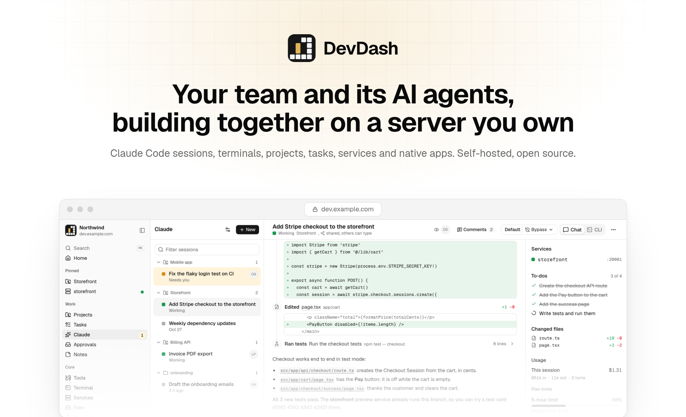
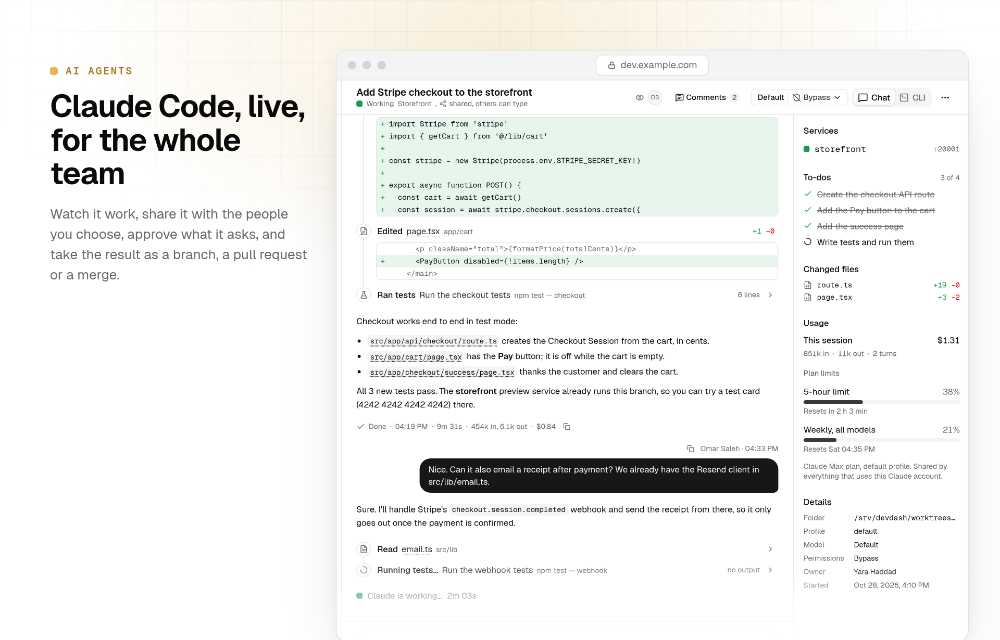
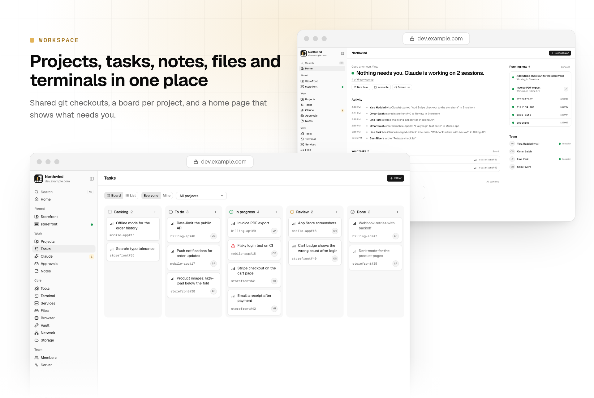
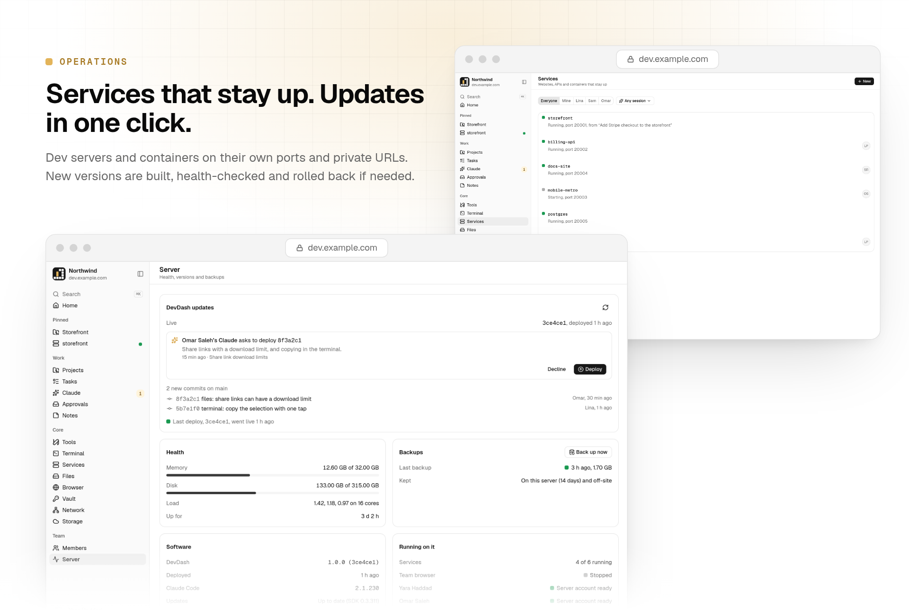
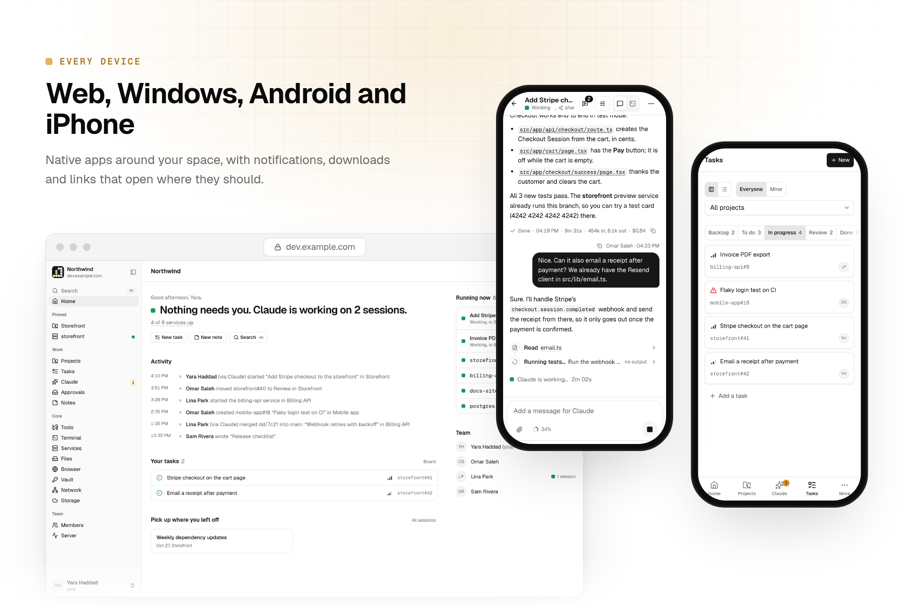
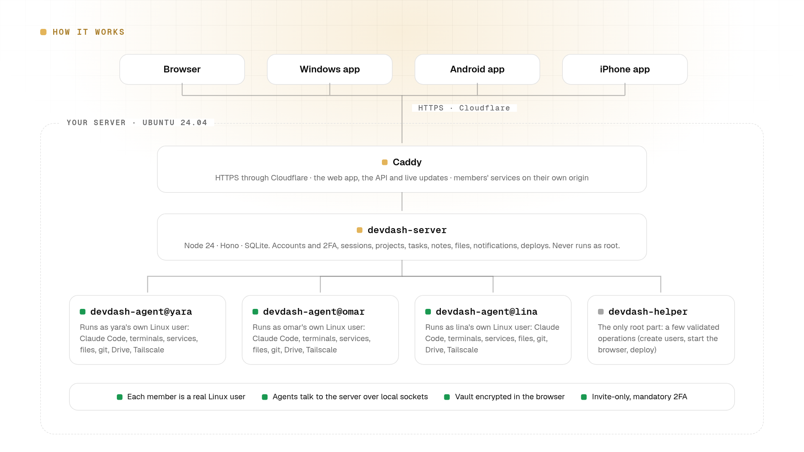

<div align="center">

<picture>
  <source media="(prefers-color-scheme: dark)" srcset=".github/assets/hero-dark.png">
  
</picture>

<br>

**A self-hosted workspace where a small team and its AI agents build software together, on one Linux server you own.**

[](LICENSE)


[Features](#features) · [How it works](#how-it-works) · [Self-hosting](#self-hosting) · [Configuration](#configuration) · [Native apps](#native-apps) · [Development](#development) · [Security](#security)

</div>

---

## Why DevDash

Coding agents do their best work next to the code, around the clock, on a machine the whole team can reach. DevDash
turns a single server into that place:

- **One environment for everyone.** Projects are shared git checkouts on the server. Each agent session can work in its
  own git worktree, so parallel work never collides.
- **Agents are teammates, not tabs.** Start Claude Code from the browser or your phone, watch it work live, share the
  session with a colleague, answer its questions, and pick up the result as a branch, a pull request or a merge.
- **Everyone stays separate.** Each person is a real Linux user with their own home, shell, Claude login, cloud storage
  and private network. DevDash itself never runs as root.
- **You own it.** One server, one domain, MIT licensed. No SaaS account and no data leaving your machine, except what
  you choose to connect.

> The screenshots in this README show a demo space with sample data.

## Features

### AI agents

<picture>
  <source media="(prefers-color-scheme: dark)" srcset=".github/assets/agents-dark.png">
  
</picture>

Every session is Claude Code itself, run as the member who started it.

- **Two ways to work.** A chat view built on the Claude Agent SDK, with tool steps, diffs, subagents, to-do lists and
  file links that open in a viewer, or the real Claude Code CLI in a terminal. Switch a session between them any time.
- **Your own Claude account.** Each member signs in to their own Claude plan, with optional extra profiles. Cost,
  tokens, context and plan limits are shown per session.
- **Shared on your terms.** Keep a session private, share it with the whole team or with chosen people, read-only or
  with permission to type. Comments, live viewers and "ask to join" included.
- **A worktree per session.** A session can get a fresh worktree on its own branch. When it's done, *Ready to review*
  shows the diff and opens a GitHub pull request or merges it on the server.
- **Project instructions** apply to every new session in a project, like a Claude Project.
- **Team roles (optional).** AI team members per project (CEO, CTO, marketing and so on) with goals, schedules,
  triggers, threads, approvals and a shared notebook. Switch them off server-wide with `DEVDASH_TEAM=0`.

### Workspace

<picture>
  <source media="(prefers-color-scheme: dark)" srcset=".github/assets/workspace-dark.png">
  
</picture>

Everything the team and its agents work on, in one place.

- **Home** shows what needs you, what's running and what changed.
- **Projects** are git checkouts shared by the team, cloned from GitHub or imported from a zip (up to 20 GB, resumable).
- **Tasks and notes:** a board per project and Markdown notes. Agents use them too, through MCP tools.
- **Files:** browse, upload (chunked and resumable), preview, and share links with an expiry date, a password and a
  download limit.
- **Terminals:** a persistent shell per member, on the web and in the apps, with a key bar on phones.
- **Vault:** end-to-end encrypted passwords and secrets. The server only ever stores ciphertext.
- **Remote browser:** one shared Chromium, streamed into DevDash and started on demand.
- **Search and pins** across all of it.

### Operations

<picture>
  <source media="(prefers-color-scheme: dark)" srcset=".github/assets/ops-dark.png">
  
</picture>

The server takes care of itself.

- **Services:** dev servers, APIs, workers and containers registered with `devdash service add`. Each one gets a port,
  restarts if it crashes, starts with the server and opens at a members-only URL, or inside DevDash itself.
- **Builds:** run GitHub Actions workflows, follow their logs and download artifacts, using each member's own `gh` login.
- **One-click updates:** the *Server* page lists new commits on your DevDash repository. The one you approve is built,
  health-checked and rolled back on its own if it isn't healthy. Agents in DevDash's own project can ask for a deploy,
  but never deploy themselves.
- **Health and backups** at a glance: memory, disk, load, versions and nightly backups.

### Every device

<picture>
  <source media="(prefers-color-scheme: dark)" srcset=".github/assets/devices-dark.png">
  
</picture>

- **Web:** any modern browser, installable as an app.
- **Windows:** a native app that updates itself from your space.
- **Android:** background notifications, system downloads, and links that open in your browser.
- **iPhone and iPad:** an unsigned build for AltStore or SideStore, or a signed build.
- **Notifications** reach every device: Web Push, the Android app's background connection, ntfy, and the desktop app.

### Per-member integrations

- **Cloud storage:** each member can connect their own Google Drive. Their agents move heavy files (videos, builds,
  datasets) there instead of filling the server's disk.
- **Private network:** each member can join their own Tailscale tailnet in userspace, so their agents can reach their
  devices without exposing them to anyone else.

## How it works

<picture>
  <source media="(prefers-color-scheme: dark)" srcset=".github/assets/architecture-dark.png">
  
</picture>

- **Caddy** terminates HTTPS (behind Cloudflare) and serves the web app, the API and live updates. Members' services are
  served from a separate origin.
- **`devdash-server`** holds accounts, sessions, projects, tasks, notes, files, notifications and deploys in SQLite. It
  runs as its own unprivileged user.
- **`devdash-agent@<member>`** runs as each member's Linux user: Claude Code, terminals, services, files, git, Drive and
  Tailscale all happen with that person's own permissions. It talks to the server over a local socket.
- **`devdash-helper`** is the only part that runs as root. It accepts a handful of validated operations: creating users,
  starting the shared browser and deploying.

| Part | Stack | Where |
| --- | --- | --- |
| Server | Node 24, Hono, built-in `node:sqlite`, TypeScript run directly by Node | [`apps/server`](apps/server) |
| Agent | Node 24, Claude Agent SDK, node-pty, tmux; one systemd service per member | [`apps/agent`](apps/agent) |
| Web app | React, TanStack Router and Query, Tailwind CSS, shadcn/ui, Vite | [`apps/web`](apps/web) |
| Native apps | Tauri 2 (Windows, Android, iOS), with small Kotlin and Swift additions | [`apps/shell`](apps/shell) |
| Claude plugin | MCP tools that let agents use tasks, notes, services and more | [`packages/claude-plugin`](packages/claude-plugin) |
| Host setup | Bash, systemd units, Caddy | [`deploy`](deploy) |

## Self-hosting

### Requirements

- A fresh **Ubuntu 24.04** server you can reach as root over SSH. 4 vCPUs and 8 GB of RAM is a comfortable start for a
  small team; agents, builds and services all run here, so more helps.
- A **domain proxied by Cloudflare** (the firewall only admits Cloudflare on port 443).
- Optional: **Docker**, for the shared remote browser.

The setup installs Node 24, Caddy, the GitHub CLI, rclone and Tailscale (pinned and checksum-verified where
applicable) and configures SSH hardening, a firewall, swap and automatic security updates. Claude Code is installed and
kept up to date from the *Server* page; each member then signs in with their own Claude account.

### Install

1. **Prepare the host** (SSH keys only, a firewall that admits only Cloudflare on 443, Node 24, Caddy):

   ```sh
   scp deploy/bootstrap.sh deploy/ufw-cloudflare.sh root@SERVER:/root/
   ssh root@SERVER /root/bootstrap.sh <admin-user> "$(cat ~/.ssh/id_ed25519.pub)"
   ```

2. **Deploy from your clone**, naming your space and its domain:

   ```sh
   deploy/deploy.sh root@SERVER --domain dev.example.com --name "My team"
   ```

3. **Create the first admin** on the server, then open the link it prints:

   ```sh
   devdash invite --email you@example.com --username <admin-user> --role admin
   ```

   Accounts are invite-only. Every member sets a password and two-factor authentication, and gets their own Linux user.

4. **TLS.** Until a Cloudflare Origin CA certificate is installed at `/etc/caddy/certs/origin.crt` and
   `/etc/caddy/certs/origin.key`, Caddy serves an internal certificate. Add them and run step 2 again.

### Updating

After the first deploy, admins update from the *Server* page. By default it follows this repository's `main` branch.
A fork points it at its own repository:

```sh
# /etc/devdash/devdash.env
DEVDASH_REPO=your-name/your-fork
DEVDASH_GITHUB_TOKEN=github_pat_...   # only for a private fork: fine-grained, Contents read-only, that repository only
```

You can always redeploy from a clone with `deploy/deploy.sh root@SERVER`.

## Configuration

Settings live in `/etc/devdash/devdash.env` on the server (created by the installer) and in `.env` for local
development (see [`.env.example`](.env.example)).

| Variable | Default | Purpose |
| --- | --- | --- |
| `DEVDASH_ORIGIN` | *(required)* | Public URL of the space, as the browser sees it. |
| `DEVDASH_MASTER_KEY` | *(required)* | 32 random bytes, base64. Encrypts secrets at rest; keep a backup. |
| `DEVDASH_DATA_DIR` | *(required)* | Where the SQLite database and uploads live. |
| `DEVDASH_SPACE_NAME` | `DevDash` | Name shown in the app and on its public pages. |
| `DEVDASH_PORT` | `8787` | Port the server listens on (behind Caddy). |
| `DEVDASH_TRUST_CF_IP` | `0` | `1` when the origin is reachable only through Cloudflare. |
| `DEVDASH_PROJECTS_ROOT` | `/srv/devdash` | Shared checkouts (`projects/`), worktrees and the team's shared files. |
| `DEVDASH_SERVICES_PORT` | `8443` | Port of the separate origin that serves members' services. |
| `DEVDASH_REPO` | this repository | GitHub repository the *Server* page deploys from and the apps update from. |
| `DEVDASH_GITHUB_TOKEN` | *(none)* | Read-only token for a private `DEVDASH_REPO`. |
| `DEVDASH_TEAM` | on | `0` switches Team roles off server-wide. |

Google Drive storage, Web Push, ntfy and Apple push are configured by admins inside the app.

## Native apps

The apps are thin, signed shells around your space. On first launch they ask for its address and remember it.

- **Downloads:** every space serves the latest release at `https://<your-space>/api/app`.
- **Updates:** the Windows app updates itself from your space; every update is checked against the app's signing key.

To ship your own builds, change the app `identifier` in
[`apps/shell/src-tauri/tauri.conf.json`](apps/shell/src-tauri/tauri.conf.json), generate an updater key pair with
`npx tauri signer generate`, put its public key in the same file, and add the private key to your repository's
secrets. The release workflow ([`.github/workflows/app-release.yml`](.github/workflows/app-release.yml)) lists every
secret it uses.

## Development

```sh
cp .env.example .env                    # then set DEVDASH_MASTER_KEY
npm install
git config core.hooksPath .githooks     # secret scanning before every commit (needs gitleaks)
npm run dev:server & npm run dev:web    # http://localhost:5173
npm run invite -- --email you@example.com --username you --role admin
```

Before sending a change:

```sh
npm run typecheck
npm test
```

The web app, accounts, projects, tasks and notes run locally. Features that need the host (member agents, terminals,
services, the root helper) need a real install.

### Repository layout

```
apps/
  server/         HTTP API, WebSockets, SQLite migrations, admin CLI
  agent/          per-member agent: Claude Code, terminals, services, files, git
  web/            the web app
  shell/          Tauri desktop and mobile apps (Kotlin and Swift additions in android/ and plugins/)
packages/
  claude-plugin/  MCP tools and skills DevDash gives to Claude Code
deploy/           host bootstrap, installer, systemd units, Caddyfile, root helper, deploy scripts
```

## Security

DevDash gives its members shell access to a server, so it is built to contain them:

- Invite-only accounts, Argon2id passwords and mandatory TOTP two-factor authentication.
- Every member runs as their own Linux user in a resource-limited systemd slice. The server never runs as root, and the
  root helper accepts only a few validated operations.
- Vault items are encrypted in the browser; the server stores ciphertext only.
- Members' services are served from a separate origin; DevDash's own pages ship a strict Content Security Policy.
- The firewall admits only Cloudflare on 443. Without signing in, only the space's description and privacy pages,
  share links, watch-only browser invites and the app downloads are reachable.

Please report vulnerabilities privately, as described in [SECURITY.md](SECURITY.md).

## Contributing

Issues and pull requests are welcome. Read [CONTRIBUTING.md](CONTRIBUTING.md) first; it covers the development setup,
tests, code style and how changes are reviewed.

## License

[MIT](LICENSE)
