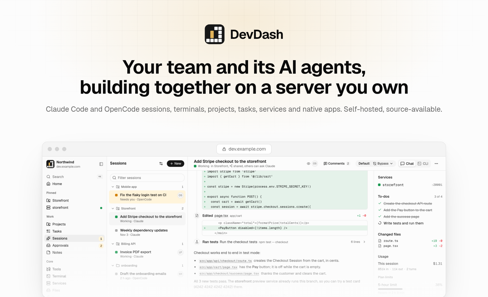
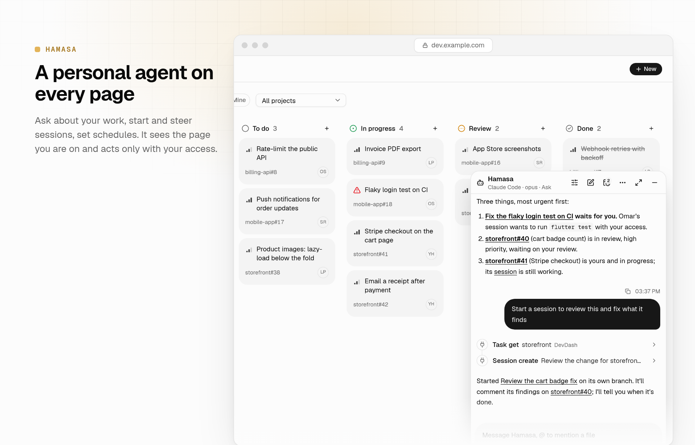
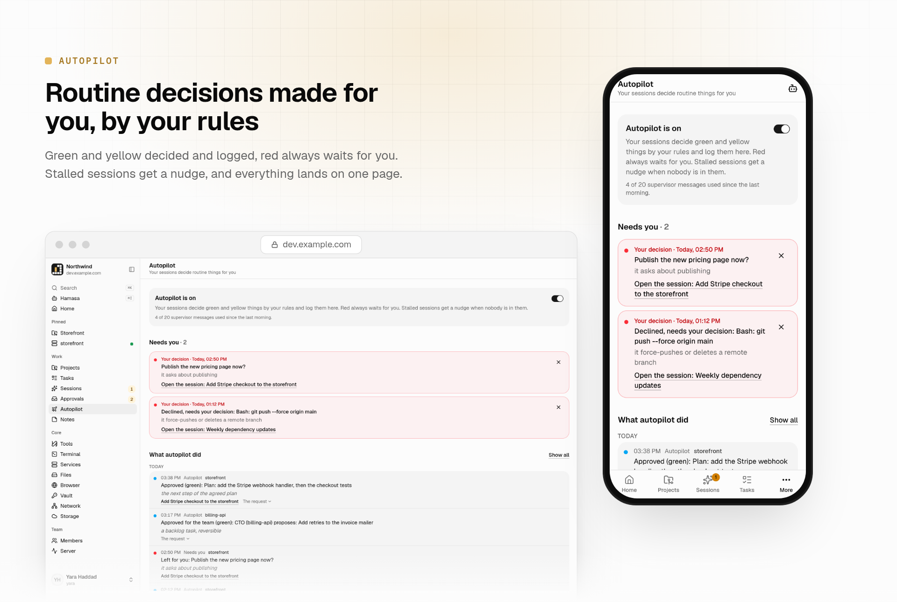
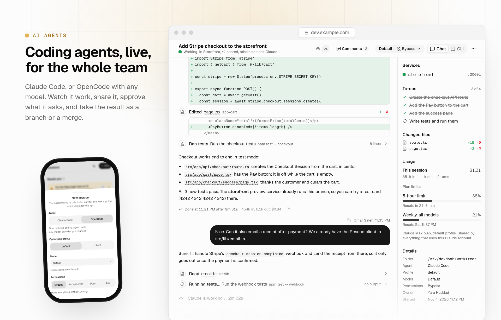
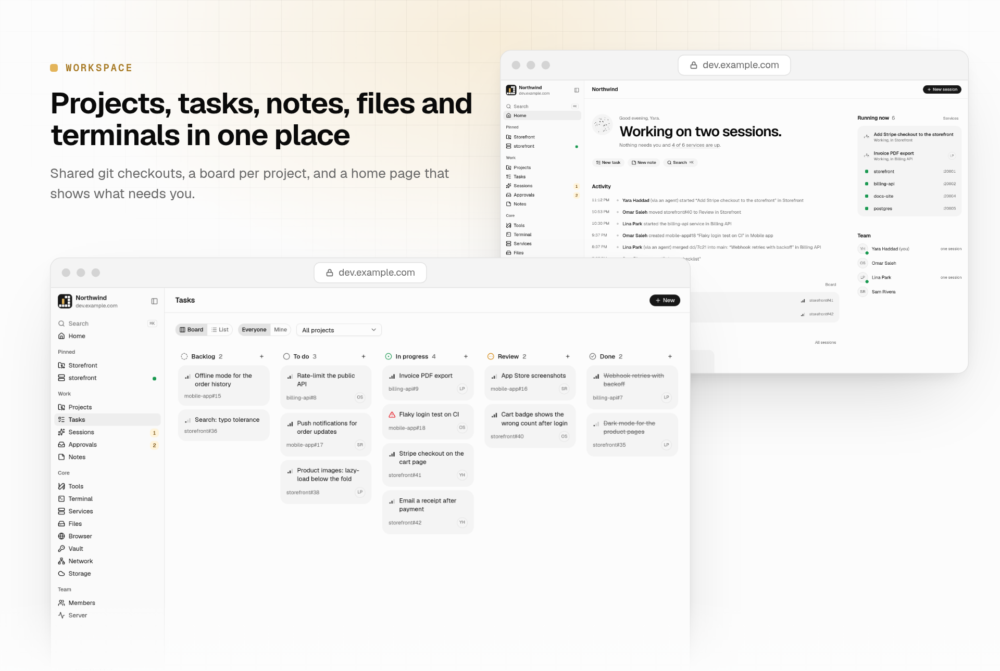
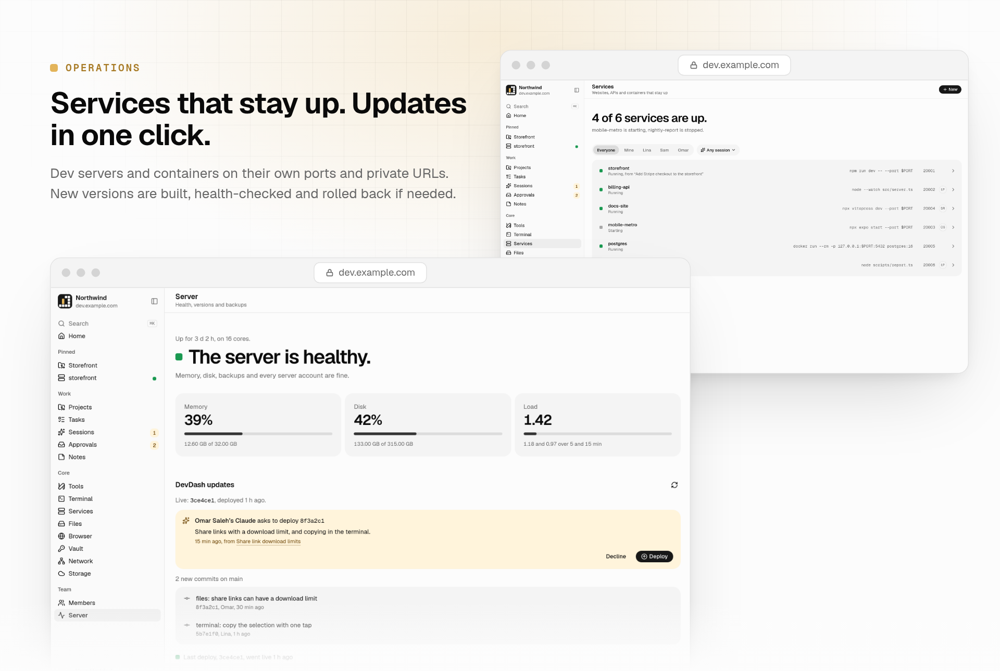
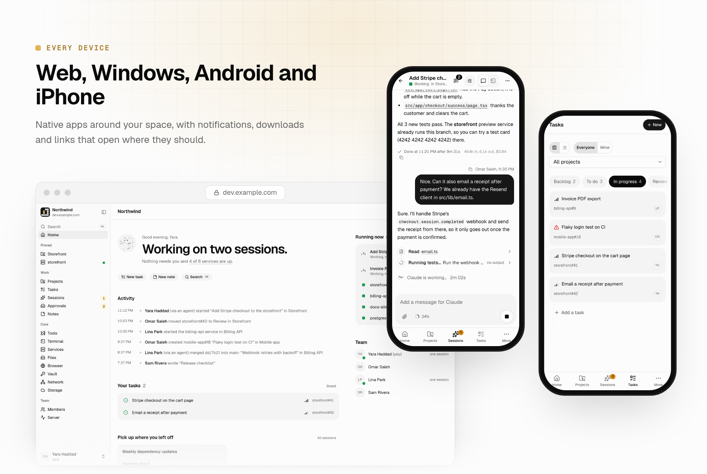
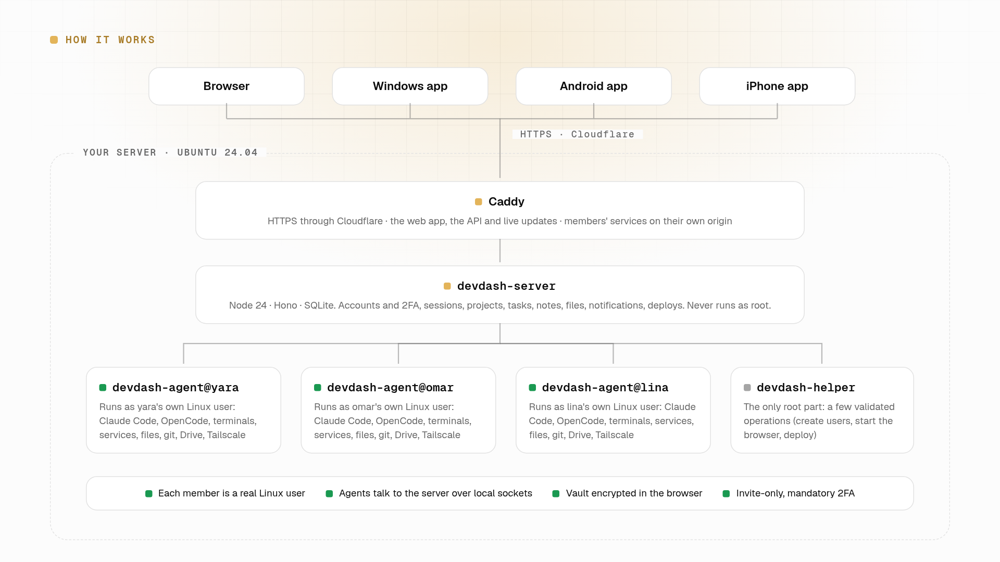

<div align="center">

<picture>
  <source media="(prefers-color-scheme: dark)" srcset=".github/assets/hero-dark.png">
  
</picture>

<br>

**A self-hosted workspace where a small team and its AI agents build software together, on one Linux server you own.**

Built by [Abdulrahman Mohamed](https://github.com/abdvlrqhman) and [Youssef Eldeeb](https://github.com/yovsefx).

[](LICENSE)


[](#supported-agents)

[Supported agents](#supported-agents) · [Hamasa](#hamasa-your-personal-agent) · [Autopilot](#autopilot) · [Features](#features) · [How it works](#how-it-works) · [Self-hosting](#self-hosting) · [Configuration](#configuration) · [Native apps](#native-apps) · [Development](#development) · [Security](#security)

</div>

---

## Why DevDash

Coding agents do their best work next to the code, around the clock, on a machine the whole team can reach. DevDash
turns a single server into that place:

- **One environment for everyone.** Projects are shared git checkouts on the server. Each agent session can work in its
  own git worktree, so parallel work never collides.
- **Agents are teammates, not tabs.** Start Claude Code or OpenCode from the browser or your phone, watch it work live,
  share the session with a colleague, answer its questions, and pick up the result as a branch, a pull request or a merge.
- **An agent of your own.** Hamasa, a personal agent on every page, answers across all your projects, starts and steers
  sessions and runs your scheduled checks, with your access only.
- **Fewer interruptions, with you in charge.** Autopilot lets your own sessions make routine decisions by rules you
  write, keeps stalled sessions moving, and collects everything that needs you on one page.
- **Everyone stays separate.** Each person is a real Linux user with their own home, shell, agent logins, cloud
  storage and private network. DevDash itself never runs as root.
- **You own it.** One server, one domain, free for noncommercial use. No SaaS account and no data leaving your machine, except what
  you choose to connect.

> The screenshots in this README show a demo space with sample data.

## Supported agents

Every session runs one of these coding agents, picked when you start it, as the member who started it and with their
own sign-in.

| Agent | Sign in with | Models | Terminal app | Connected through |
| --- | --- | --- | --- | --- |
| **[Claude Code](https://claude.com/product/claude-code)** | Your Claude plan, or an Anthropic API key | Claude: Opus, Sonnet, Haiku | The Claude Code CLI | [Claude Agent SDK](https://code.claude.com/docs/en/agent-sdk/overview) |
| **[OpenCode](https://opencode.ai)** | The OpenCode account, an OpenCode Go subscription, or any provider: ChatGPT, GitHub Copilot, API keys | Any provider's: Anthropic, OpenAI, Google, OpenRouter, local models and more | OpenCode's TUI | [Agent Client Protocol](https://agentclientprotocol.com) |

Both get the same DevDash around them: the chat view with tool steps, diffs, permission prompts and questions, to-dos,
subagents, cost and context; sessions shared with teammates; a worktree per session; team roles; profiles; and
DevDash's own tools for tasks, notes and services. Claude Code also shows your Claude plan's limits, fast mode and
Remote Control.

More agents that speak ACP (Gemini CLI, Goose, Codex through its adapter and others) can follow: each one is an entry in
[`apps/agent/src/harness.ts`](apps/agent/src/harness.ts).

## Features

### Hamasa, your personal agent

<picture>
  <source media="(prefers-color-scheme: dark)" srcset=".github/assets/hamasa-dark.png">
  
</picture>

Every member has their own agent, one shortcut away (⌘I or Ctrl+I) on every page, in the browser and the apps.

- **Knows your work.** It answers from everything you can see, across all projects: tasks, notes, sessions, services and
  your devices. It knows which page you're on, so "this" and "here" mean what you're looking at.
- **Acts for you.** It creates and updates tasks and notes, starts a coding session in the right project with a full
  brief, sends follow-ups to your running sessions or stops them, opens pages for you and notifies your phone.
- **Starts projects on your word.** Ask it for a new project and it creates one the same way the Projects page does
  (empty, or cloned from a repository), then starts work there. DevDash refuses it unless you asked in a message you
  wrote yourself: never from a schedule, autopilot or a teammate's request.
- **Works on a schedule.** Ask for a morning brief on weekdays, or a one-off check after tonight's deploy. Scheduled runs
  report in a few lines and notify you only when something needs you.
- **Your agent, your access.** It runs as your own Linux user, on Claude Code or OpenCode, with the model, effort and
  permission level you pick. Reading is free; anything that changes things asks first unless you choose otherwise. It
  can reach your tailnet and your Google Drive when you switch them on. It can't answer another session's questions
  for you: it tells you which one is waiting and links it.
- **A real session underneath.** Questions, permissions, history, past conversations and notifications work as in any
  other session.

### Autopilot

<picture>
  <source media="(prefers-color-scheme: dark)" srcset=".github/assets/autopilot-dark.png">
  
</picture>

Autopilot lets your own sessions make routine decisions for you, by rules you write, and keeps them moving while you're
away. It's per member and off until you turn it on at `/autopilot`.

**Your rules.** Plain text you can edit, in three tiers. The default rules start out like this:

| Tier | What happens | Examples |
| --- | --- | --- |
| **Green** | Decide, log it, keep going | The next step of a plan you agreed to; choosing between options by your known preferences; test runs, renders, screenshots; fixing bugs it found; committing |
| **Yellow** | Decide, log it as yellow, keep going | Changing something you already decided (with data behind it); restructuring work that already works; adding a new library, service or database change; touching more than one project |
| **Red** | Never decided, always waits for you | Publishing outside an agreed plan; sending to people; anything paid; deleting what isn't scratch work; accounts, credentials, sharing or security; starting a new project; changing the rules |

**In your sessions.** While autopilot is on, DevDash adds your rules to the messages you send in your own sessions, Claude
Code and OpenCode alike: in full the first time, then as a one-line reminder. A teammate's message in your session never
carries them. Each decision is logged with the `autopilot_log` tool, which refuses red decisions, a teammate's turn and
autopilot being off. Turning autopilot off reaches running sessions with your next message.

**The supervisor.** For your own sessions only, it steps in when one goes quiet or asks something:

- **A session stopped before it was done** gets a nudge after a quiet gap (20 minutes by default): the next step, as
  you'd write it. At most 3 nudges per goal; the same error twice, and it goes to *Needs you* instead.
- **A question, a plan or a permission prompt** gets a look 2 minutes after it appears (1 to 5, your choice), so you
  can answer first. Green and yellow answers and approvals go through, marked as autopilot's. A question about anything
  red is never answered, not even with the safe "No". With *Autopilot handles approvals* on, a red request is declined
  with a note that tells the session to carry on with other work, and lands in *Needs you*. Requests that are red on
  their face (deleting outside `/tmp`, a force-push, `git reset --hard`, dropping data, publishing, sudo) are declined
  without a model call.
- **Never automatic:** a teammate's request that would use your access, and DevDash deploy requests.
- **Never while someone's there:** nobody may have the session open, a teammate's message mustn't be the last, and a
  turn mustn't be running.

**Your AI team.** In the projects you turn on (each one off by default), autopilot also answers what the project's role
agents ask people: proposals on *Approvals* and questions in team threads. Each waits 30 minutes for a teammate first.
Green and yellow ones are approved or answered as you, marked as autopilot's; it never declines, and the rest lands in
*Needs you*. When a role replies in a thread one of your sessions started, the session gets the reply.

**Supervisor settings.** The *Supervisor* block on `/autopilot` lets you pick which agent (Claude Code or OpenCode),
account (profile) and model the supervisor runs on. Default: Claude Code, your default profile, Sonnet. Stronger models
judge better but use more of your plan. When a configured model or profile stops existing, it falls back to the default
and says so.

**Limits.** Autopilot runs on your own plan and leaves room for you: for Claude, it backs off at 80% of a 5-hour
window and 90% of a weekly one, and resumes when the window resets. For OpenCode (whose plan usage can't be read), a
daily model-call cap (100 by default) pauses the supervisor until the next morning. A nightly message cap (20 by
default) bounds it further.

**One page for all of it.** `/autopilot` has the switch, *Needs you* (red questions, declined requests, stuck
sessions, with links), what autopilot did lately, supervisor settings, your settings and your rules. The full activity
log, with search, filters and sorting, is one tap away. A morning ping (09:00 by default) arrives only when something
needs you or a yellow decision is new.

<details>
<summary>How a decision flows</summary>

1. A session of yours asks: *"Should the checkout use Stripe Checkout or Elements?"*
2. For 2 minutes, nothing happens: you can answer yourself.
3. Then autopilot checks that nobody has the session open, that the turn is yours, and that the nightly cap and your
   plan's usage leave room.
4. It reads the end of the conversation and your rules. Choosing by your known preferences is green, so it answers
   *"Checkout (answered by Autopilot…)"* and the session continues.
5. The log shows what it chose and why. Had the question been *"Publish the pricing page now?"*, it would have gone
   straight to *Needs you* without an answer.

</details>

### AI agents

<picture>
  <source media="(prefers-color-scheme: dark)" srcset=".github/assets/agents-dark.png">
  
</picture>

Every session is a real coding agent, run as the member who started it.

- **Your choice of agent.** Each session runs Claude Code, or OpenCode with any model provider: Anthropic, OpenAI,
  Google, OpenRouter, GitHub Copilot, local models and more. Pick it per session; team roles pick theirs too. DevDash
  drives Claude Code through its Agent SDK and OpenCode over the [Agent Client Protocol](https://agentclientprotocol.com),
  so more ACP agents can follow.
- **Two ways to work.** A chat view with tool steps, diffs, subagents, to-do lists, permission prompts, questions and
  file links that open in a viewer, or the agent's own terminal app (the Claude Code CLI, OpenCode's TUI). Switch a
  session between them any time. In the chat, typing `/model` or `/effort` switches the session like its menu does, and
  code blocks have copy buttons.
- **Your own accounts.** Each member signs in to their own Claude plan, and to OpenCode with its own account, an OpenCode
  Go subscription or any provider (ChatGPT, GitHub Copilot, API keys), with optional extra profiles for each. Sign-ins
  run in a terminal tab with a code to enter on any device. Cost, tokens and context are shown per session, and Claude
  plan limits too.
- **Shared on your terms.** Keep a session private, share it with the whole team or with chosen people, read-only or
  with permission to type. Comments, live viewers and "ask to join" included.
- **A worktree per session.** A session can get a fresh worktree on its own branch. When it's done, *Ready to review*
  shows the diff and opens a GitHub pull request or merges it on the server.
- **Project instructions** apply to every new session in a project, like a Claude Project.
- **Skills.** Add skills for all your agents under *More → Skills*, or for one project in its *Skills* tab, where each
  change is a commit of its own in `.claude/skills`. Write them in DevDash, upload a `.zip` or `.skill`, or fetch them
  from a GitHub link. Uploads and links are reviewed first, with scripts and binaries marked, and nothing from a skill
  runs while it installs.
- **Team roles (optional).** AI team members per project (CEO, CTO, marketing and so on), on Claude Code or OpenCode, with goals, schedules,
  triggers, threads, approvals and a shared notebook. Switch them off server-wide with `DEVDASH_TEAM=0`.

### Workspace

<picture>
  <source media="(prefers-color-scheme: dark)" srcset=".github/assets/workspace-dark.png">
  
</picture>

Everything the team and its agents work on, in one place.

- **Home** shows what needs you, what's running and what changed.
- **Projects** are git checkouts shared by the team, cloned from GitHub or imported from a zip (up to 20 GB, resumable).
  Whoever added a project can delete it: the dialog shows what's at risk first (uncommitted work, commits not on
  GitHub, running sessions and services), and *Recently deleted* restores it for seven days.
- **Tasks and notes:** a board per project and Markdown notes. Agents use them too, through MCP tools.
- **Files:** browse, upload (chunked and resumable), preview, and share links with an expiry date, a password and a
  download limit.
- **Terminals:** a persistent shell per member, on the web and in the apps, with a key bar on phones.
- **Vault:** end-to-end encrypted passwords and secrets. The server only ever stores ciphertext.
- **Remote browser:** one shared Chromium, streamed into DevDash and started on demand.
- **Search and pins** across all of it.

### Operations

<picture>
  <source media="(prefers-color-scheme: dark)" srcset=".github/assets/ops-dark.png">
  
</picture>

The server takes care of itself.

- **Services:** dev servers, APIs, workers and containers registered with `devdash service add`. Each one gets a port,
  restarts if it crashes, starts with the server and opens at a members-only URL, or inside DevDash itself.
- **Builds:** run GitHub Actions workflows, follow their logs and download artifacts, using each member's own `gh` login.
- **One-click updates:** the *Server* page lists new commits on your DevDash repository. The one you approve is built,
  health-checked and rolled back on its own if it isn't healthy. Agents in DevDash's own project can ask for a deploy,
  but never deploy themselves.
- **Health and backups** at a glance: memory, disk, load, versions and nightly backups.

### Every device

<picture>
  <source media="(prefers-color-scheme: dark)" srcset=".github/assets/devices-dark.png">
  
</picture>

- **Web:** any modern browser, installable as an app.
- **Windows:** a native app that updates itself from your space.
- **Android:** background notifications, system downloads, and links that open in your browser.
- **iPhone and iPad:** an unsigned build for AltStore or SideStore, or a signed build.
- **Notifications** reach every device: Web Push, the Android app's background connection, ntfy, and the desktop app.

### Per-member integrations

- **Cloud storage:** each member can connect their own Google Drive. Their agents move heavy files (videos, builds,
  datasets) there instead of filling the server's disk.
- **Private network:** each member can join their own Tailscale tailnet in userspace, so their agents can reach their
  devices without exposing them to anyone else.

## How it works

<picture>
  <source media="(prefers-color-scheme: dark)" srcset=".github/assets/architecture-dark.png">
  
</picture>

- **Caddy** terminates HTTPS (behind Cloudflare) and serves the web app, the API and live updates. Members' services are
  served from a separate origin.
- **`devdash-server`** holds accounts, sessions, projects, tasks, notes, files, notifications and deploys in SQLite. It
  runs as its own unprivileged user.
- **`devdash-agent@<member>`** runs as each member's Linux user: Claude Code, OpenCode, terminals, services, files, git, Drive and
  Tailscale all happen with that person's own permissions. It talks to the server over a local socket.
- **`devdash-helper`** is the only part that runs as root. It accepts a handful of validated operations: creating users,
  starting the shared browser and deploying.

| Part | Stack | Where |
| --- | --- | --- |
| Server | Node 24, Hono, built-in `node:sqlite`, TypeScript run directly by Node | [`apps/server`](apps/server) |
| Agent | Node 24, Claude Agent SDK, Agent Client Protocol (OpenCode), node-pty, tmux; one systemd service per member | [`apps/agent`](apps/agent) |
| Web app | React, TanStack Router and Query, Tailwind CSS, shadcn/ui, Vite | [`apps/web`](apps/web) |
| Native apps | Tauri 2 (Windows, Android, iOS), with small Kotlin and Swift additions | [`apps/shell`](apps/shell) |
| Agent plugins | MCP tools that let agents use tasks, notes, services and more; status from the agents' terminal apps | [`packages/claude-plugin`](packages/claude-plugin), [`packages/opencode-plugin`](packages/opencode-plugin) |
| Host setup | Bash, systemd units, Caddy | [`deploy`](deploy) |

## Self-hosting

### Requirements

- A fresh **Ubuntu 24.04** server you can reach as root over SSH. 4 vCPUs and 8 GB of RAM is a comfortable start for a
  small team; agents, builds and services all run here, so more helps.
- A **domain proxied by Cloudflare** (the firewall only admits Cloudflare on port 443).
- Optional: **Docker**, for the shared remote browser.

The setup installs Node 24, Caddy, the GitHub CLI, rclone and Tailscale (pinned and checksum-verified where
applicable) and configures SSH hardening, a firewall, swap and automatic security updates. The coding agents,
Claude Code and OpenCode, are installed and kept up to date from the *Server* page, one click each; members then sign
in to their own Claude account or OpenCode providers on *Agent setup*.

### Install

1. **Prepare the host** (SSH keys only, a firewall that admits only Cloudflare on 443, Node 24, Caddy):

   ```sh
   scp deploy/bootstrap.sh deploy/ufw-cloudflare.sh root@SERVER:/root/
   ssh root@SERVER /root/bootstrap.sh <admin-user> "$(cat ~/.ssh/id_ed25519.pub)"
   ```

2. **Deploy from your clone**, naming your space and its domain:

   ```sh
   deploy/deploy.sh root@SERVER --domain dev.example.com --name "My team"
   ```

3. **Create the first admin** on the server, then open the link it prints:

   ```sh
   devdash invite --email you@example.com --username <admin-user> --role admin
   ```

   Accounts are invite-only. Every member sets a password and two-factor authentication, and gets their own Linux user.

4. **TLS.** Until a Cloudflare Origin CA certificate is installed at `/etc/caddy/certs/origin.crt` and
   `/etc/caddy/certs/origin.key`, Caddy serves an internal certificate. Add them and run step 2 again.

### Updating

After the first deploy, admins update from the *Server* page. By default it follows this repository's `main` branch.
A fork points it at its own repository:

```sh
# /etc/devdash/devdash.env
DEVDASH_REPO=your-name/your-fork
DEVDASH_GITHUB_TOKEN=github_pat_...   # only for a private fork: fine-grained, Contents read-only, that repository only
```

You can always redeploy from a clone with `deploy/deploy.sh root@SERVER`.
Or on the server, as root, deploy the newest commit of your DevDash repository's `main` (the same job the *Server* page
starts; follow it with `journalctl -fu 'devdash-deploy@*'`):

```sh
systemctl start "devdash-deploy@$(git ls-remote https://github.com/OWNER/REPO refs/heads/main | cut -f1).service"
```

## Configuration

Settings live in `/etc/devdash/devdash.env` on the server (created by the installer) and in `.env` for local
development (see [`.env.example`](.env.example)).

| Variable | Default | Purpose |
| --- | --- | --- |
| `DEVDASH_ORIGIN` | *(required)* | Public URL of the space, as the browser sees it. |
| `DEVDASH_MASTER_KEY` | *(required)* | 32 random bytes, base64. Encrypts secrets at rest; keep a backup. |
| `DEVDASH_DATA_DIR` | *(required)* | Where the SQLite database and uploads live. |
| `DEVDASH_SPACE_NAME` | `DevDash` | Name shown in the app and on its public pages. |
| `DEVDASH_PORT` | `8787` | Port the server listens on (behind Caddy). |
| `DEVDASH_TRUST_CF_IP` | `0` | `1` when the origin is reachable only through Cloudflare. |
| `DEVDASH_PROJECTS_ROOT` | `/srv/devdash` | Shared checkouts (`projects/`), worktrees and the team's shared files. |
| `DEVDASH_SERVICES_PORT` | `8443` | Port of the separate origin that serves members' services. |
| `DEVDASH_REPO` | this repository | GitHub repository the *Server* page deploys from and the apps update from. |
| `DEVDASH_GITHUB_TOKEN` | *(none)* | Read-only token for a private `DEVDASH_REPO`. |
| `DEVDASH_TEAM` | on | `0` switches Team roles off server-wide. |

Google Drive storage, Web Push, ntfy and Apple push are configured by admins inside the app.

## Native apps

The apps are thin, signed shells around your space. On first launch they ask for its address and remember it.

- **Downloads:** every space serves the latest release at `https://<your-space>/api/app`.
- **Updates:** the Windows app updates itself from your space; every update is checked against the app's signing key.

To ship your own builds, change the app `identifier` in
[`apps/shell/src-tauri/tauri.conf.json`](apps/shell/src-tauri/tauri.conf.json), generate an updater key pair with
`npx tauri signer generate`, put its public key in the same file, and add the private key to your repository's
secrets. The release workflow ([`.github/workflows/app-release.yml`](.github/workflows/app-release.yml)) lists every
secret it uses.

## Development

```sh
cp .env.example .env                    # then set DEVDASH_MASTER_KEY
npm install
git config core.hooksPath .githooks     # secret scanning before every commit (needs gitleaks)
npm run dev:server & npm run dev:web    # http://localhost:5173
npm run invite -- --email you@example.com --username you --role admin
```

Before sending a change:

```sh
npm run typecheck
npm test
```

The web app, accounts, projects, tasks and notes run locally. Features that need the host (member agents, terminals,
services, the root helper) need a real install.

### Repository layout

```
apps/
  server/         HTTP API, WebSockets, SQLite migrations, admin CLI
  agent/          per-member agent: Claude Code, OpenCode, terminals, services, files, git
  web/            the web app
  shell/          Tauri desktop and mobile apps (Kotlin and Swift additions in android/ and plugins/)
packages/
  claude-plugin/  MCP tools and skills DevDash gives to agents (OpenCode gets the same MCP tools)
  opencode-plugin/ the status of OpenCode's terminal app, for DevDash
deploy/           host bootstrap, installer, systemd units, Caddyfile, root helper, deploy scripts
```

## Security

DevDash gives its members shell access to a server, so it is built to contain them:

- Invite-only accounts, Argon2id passwords and mandatory TOTP two-factor authentication.
- Every member runs as their own Linux user in a resource-limited systemd slice. The server never runs as root, and the
  root helper accepts only a few validated operations.
- Vault items are encrypted in the browser; the server stores ciphertext only.
- Members' services are served from a separate origin; DevDash's own pages ship a strict Content Security Policy.
- The firewall admits only Cloudflare on 443. Without signing in, only the space's description and privacy pages,
  share links, watch-only browser invites and the app downloads are reachable.

Please report vulnerabilities privately, as described in [SECURITY.md](SECURITY.md).

## Contributing

Issues and pull requests are welcome. Read [CONTRIBUTING.md](CONTRIBUTING.md) first; it covers the development setup,
tests, code style and how changes are reviewed.

## License

DevDash is source-available under the [PolyForm Noncommercial License 1.0.0](LICENSE). It's free for personal and hobby
projects, schools, research and nonprofits.

**Commercial use** (a company running it, paid client work, or hosting it for others) needs a commercial license. Email
support@spacie.net and we'll work out terms.
